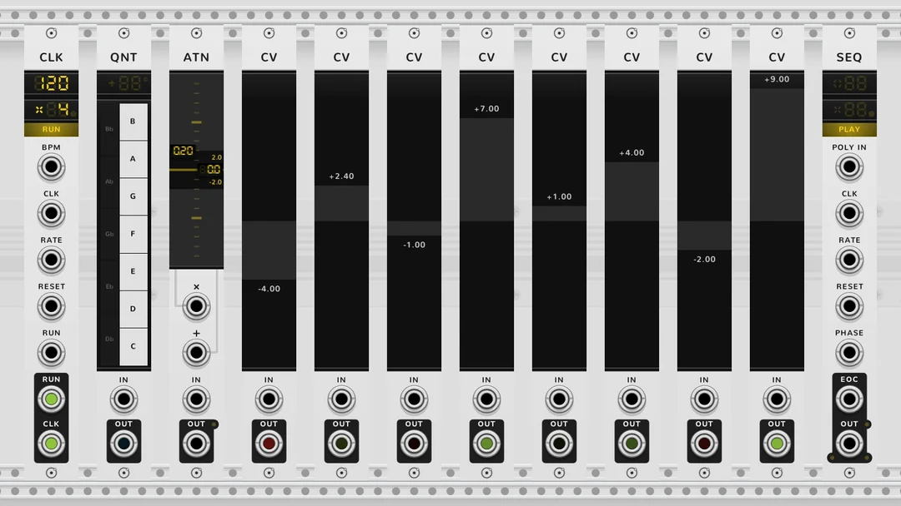

# Atomic

A plugin of eleven modules for [VCV Rack 2](https://vcvrack.com), the free virtual modular synthesizer.

  <a href="https://atomic-modular.com">
    <picture>
      <source media="(prefers-color-scheme: dark)" srcset=".github/media/hero-rails-dark.webp">
      <source media="(prefers-color-scheme: light)" srcset=".github/media/hero-rails-light.webp">
      
    </picture>
  </a>

Atomic modules bond on contact. Push them edge to edge and they work as one module of your own making: sequencers, complex LFOs, multi-segment envelopes, generative machines, sound synthesis and more, as simple or as wild as you like. Every module also works alone, patched with cables like any other.

## The manual

Everything is in the manual at [atomic-modular.com](https://atomic-modular.com). Every module has its own full guide there, in pictures and short animations, and beside them are a step-by-step walk through your first rig and the forty-one factory rigs that come with Atomic.

## Install the beta

1. Open [Releases](https://github.com/jakub-ciupinski/Atomic/releases) and download the `.vcvplugin` file for your computer from the newest release: its name ends in `mac-arm64`, `mac-x64`, `win-x64` or `lin-x64`, as the folder below does.
2. Put it, as it is, in the plugins folder inside Rack's user folder (Rack 2.5 or later; Help > Open user folder in Rack takes you there):
   - Mac with Apple silicon: `~/Library/Application Support/Rack2/plugins-mac-arm64/`
   - Intel Mac: `~/Library/Application Support/Rack2/plugins-mac-x64/`
   - Windows: `C:\Users\<you>\AppData\Local\Rack2\plugins-win-x64\`
   - Linux: `~/.local/share/Rack2/plugins-lin-x64/`
3. Restart Rack. The modules appear in the module browser under Atomic.

## Bugs and ideas

Report bugs and ideas in this repository's Issues. For a bug, give the Atomic and Rack versions, your operating system and the steps that show it; a patch file that shows it helps most.

## Building

Atomic builds from source against the Rack SDK: `make` at the root, with `RACK_DIR` pointing at the SDK (or a `Rack-SDK` link at the root).

## Licence

Atomic is free software under the GNU General Public License, version 3 or later; see `LICENSE.md` and `LICENSE-GPLv3.txt`. The Nunito font in `res/fonts` is under the SIL Open Font License, in `res/fonts/Nunito-LICENSE.txt`.
